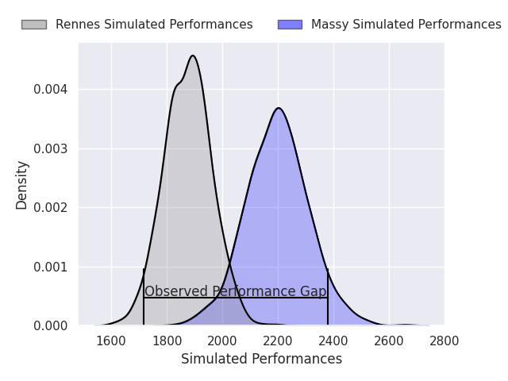
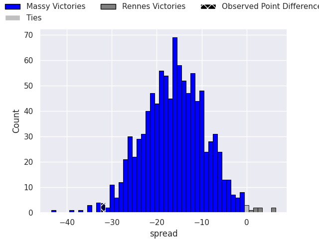
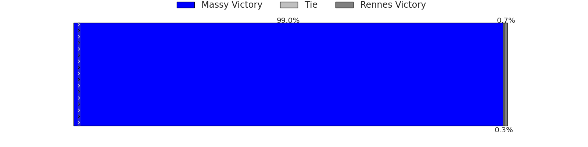

## Club Level Predictions

Now that the game has been played, lets see how the club predictions did. I predicted Massy to win by 16.09, and Massy won by 32.0. That's an absolute error of 15.9 for the margin of victory, while my average absolute error has been 14.7 over the past six months. This prediction was more accurate than 36.6% of my recent predictions.

For the Over/Under model, I predicted a total of 42.5 and we have an actual total of 58.0. That's an absolute error of 15.5 compared to a six month average of 14.3. This prediction was more accurate than 38.3% of my recent predictions.
### Projected Performances - Club Model

### Projected Spreads - Club Model

### Projected Results - Club Model

