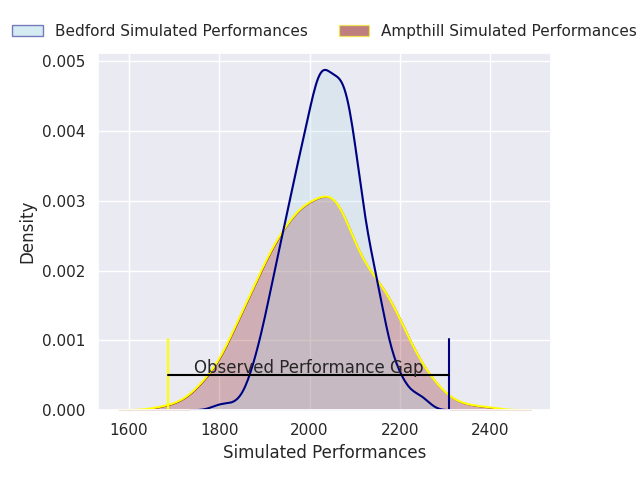
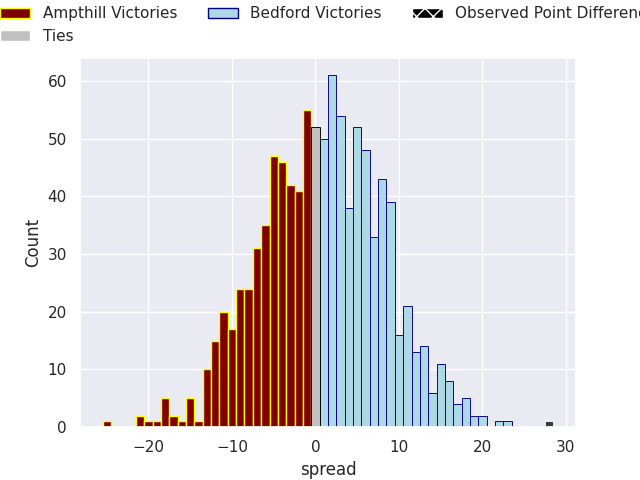
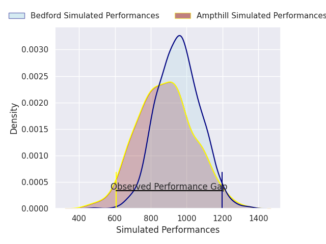
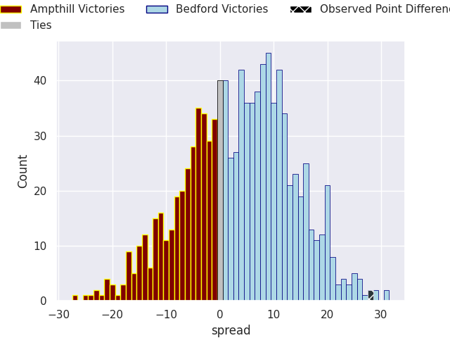
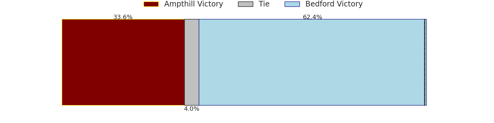

## Club Level Predictions

Now that the game has been played, lets see how the club predictions did. I predicted Bedford to win by 0.8, and Bedford won by 28.0. That's an absolute error of 27.2 for the margin of victory, while my average absolute error has been 14.7 over the past six months. This prediction was more accurate than 14.3% of my recent predictions.

For the Over/Under model, I predicted a total of 54.5 and we have an actual total of 90.0. That's an absolute error of 35.5 compared to a six month average of 14.3. This prediction was more accurate than 4.6% of my recent predictions.
### Projected Performances - Club Model

### Projected Spreads - Club Model

### Projected Results - Club Model

## Player Level Predictions

With the player model, I predicted Bedford to win by 3.68,  and Bedford won by 28.0. That's an absolute error of 24.3 for the margin of victory, while the average error as been 14.5 for the past six months. So this prediction was more accurate than 15.9% of my recent predictions.
### Projected Performances - Player Model

### Projected Spreads - Player Model

### Projected Results - Player Model

