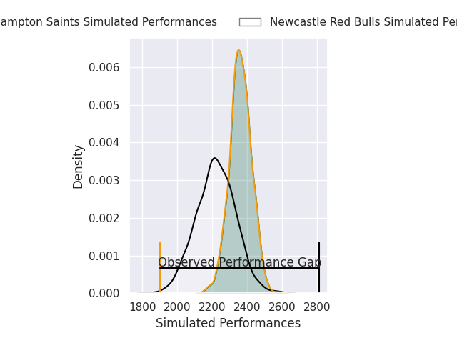
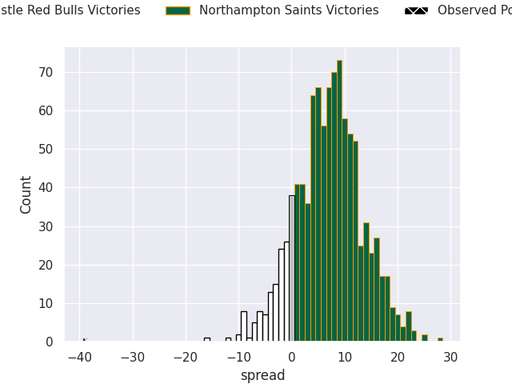
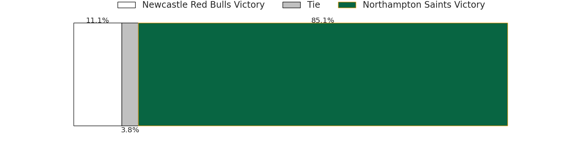

## Club Level Predictions

Now that the game has been played, lets see how the club predictions did. I predicted Northampton Saints to win by 7.06, and Newcastle Red Bulls won by 39.0. That's an absolute error of 46.1 for the margin of victory, while my average absolute error has been 14.4 over the past six months. This prediction was more accurate than 2.1% of my recent predictions.

For the Over/Under model, I predicted a total of 52.5 and we have an actual total of 59.0. That's an absolute error of 6.5 compared to a six month average of 14.3. This prediction was more accurate than 72.0% of my recent predictions.
### Projected Performances - Club Model

### Projected Spreads - Club Model

### Projected Results - Club Model

