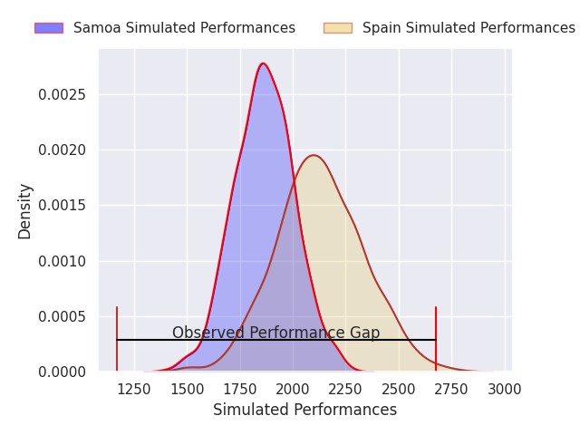
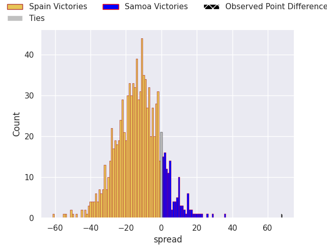

## Club Level Predictions

Now that the game has been played, lets see how the club predictions did. I predicted Spain to win by 13.21, and Samoa won by 68.0. That's an absolute error of 81.2 for the margin of victory, while my average absolute error has been 14.7 over the past six months. This prediction was more accurate than 0.0% of my recent predictions.

For the Over/Under model, I predicted a total of 50.5 and we have an actual total of 112.0. That's an absolute error of 61.5 compared to a six month average of 14.3. This prediction was more accurate than 0.4% of my recent predictions.
### Projected Performances - Club Model

### Projected Spreads - Club Model

### Projected Results - Club Model

