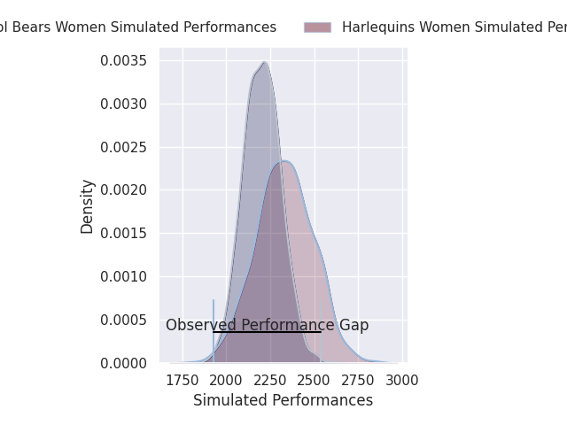
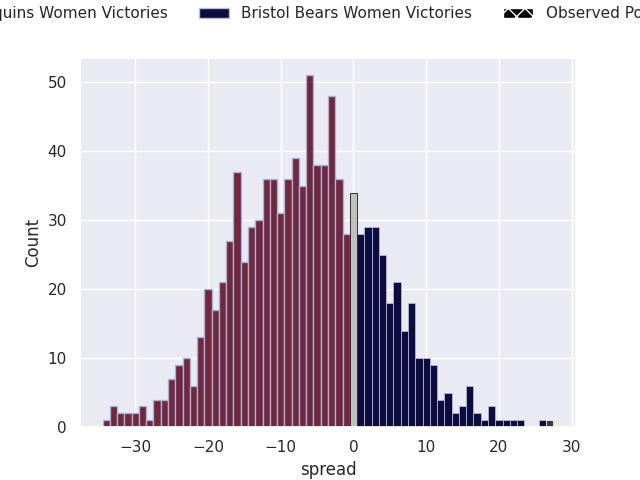
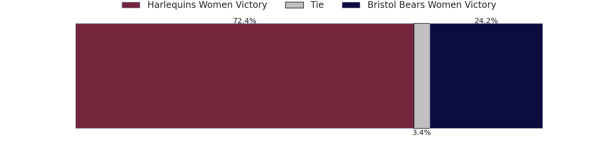

## Club Level Predictions

Now that the game has been played, lets see how the club predictions did. I predicted Harlequins Women to win by 6.37, and Bristol Bears Women won by 27.0. That's an absolute error of 33.4 for the margin of victory, while my average absolute error has been 14.7 over the past six months. This prediction was more accurate than 8.4% of my recent predictions.

For the Over/Under model, I predicted a total of 46.5 and we have an actual total of 69.0. That's an absolute error of 22.5 compared to a six month average of 14.3. This prediction was more accurate than 19.8% of my recent predictions.
### Projected Performances - Club Model

### Projected Spreads - Club Model

### Projected Results - Club Model

