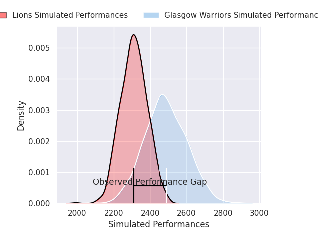
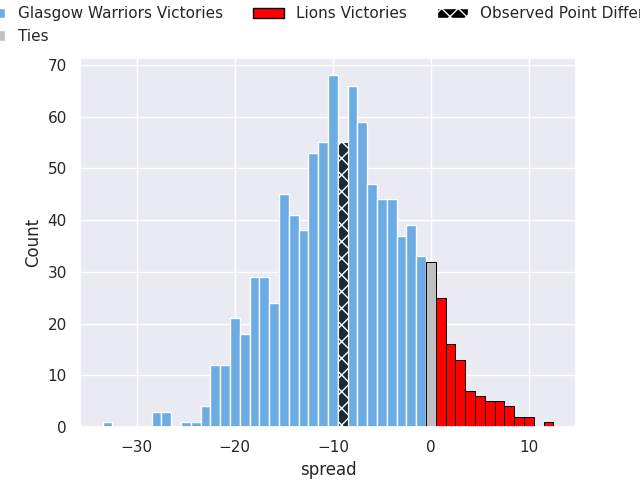
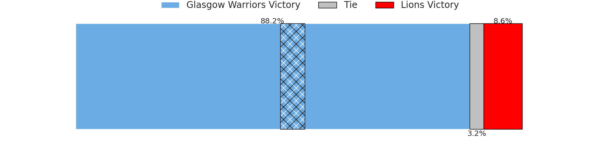

HEADERSTART
---
layout: page
title: Glasgow Warriors V Lions on 2026/10/30, 29.0 to 20.0
date: 2026-10-30
categories: rugby "United Rugby Championship 26/27" match projection
---
## Club Level Predictions

Now that the game has been played, lets see how the club predictions did. I predicted Glasgow Warriors to win by 8.72, and Glasgow Warriors won by 9.0. That's an absolute error of 0.3 for the margin of victory, while my average absolute error has been 14.5 over the past six months. This prediction was more accurate than 98.3% of my recent predictions.

For the Over/Under model, I predicted a total of 47.5 and we have an actual total of 49.0. That's an absolute error of 1.5 compared to a six month average of 14.8. This prediction was more accurate than 92.9% of my recent predictions.
### Projected Performances - Club Model

### Projected Spreads - Club Model

### Projected Results - Club Model

