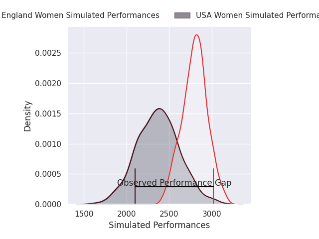
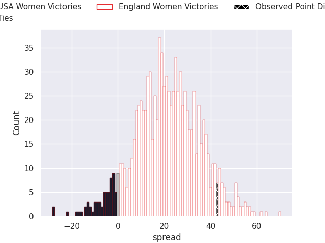
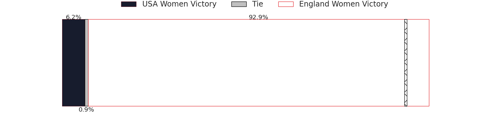

HEADERSTART
---
layout: page
title: USA Women V England Women on 2026/10/30, 12.0 to 55.0
date: 2026-10-30
categories: rugby "WXV Global Series 2026" match projection
---
## Club Level Predictions

Now that the game has been played, lets see how the club predictions did. I predicted England Women to win by 21.46, and England Women won by 43.0. That's an absolute error of 21.5 for the margin of victory, while my average absolute error has been 14.5 over the past six months. This prediction was more accurate than 21.8% of my recent predictions.

For the Over/Under model, I predicted a total of 50.5 and we have an actual total of 67.0. That's an absolute error of 16.5 compared to a six month average of 14.8. This prediction was more accurate than 37.2% of my recent predictions.
### Projected Performances - Club Model

### Projected Spreads - Club Model

### Projected Results - Club Model

