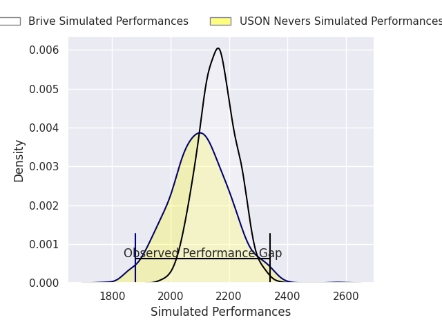
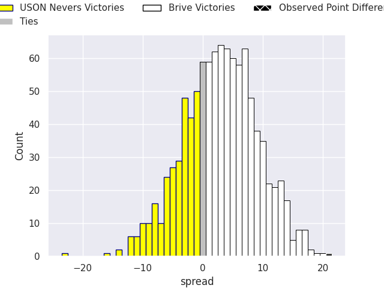
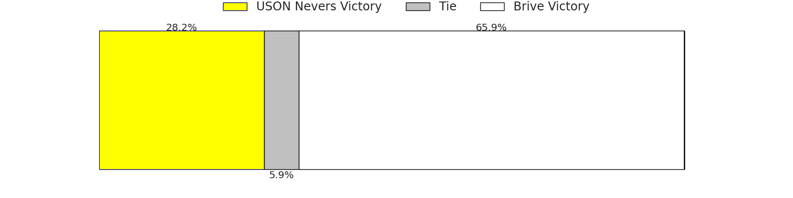
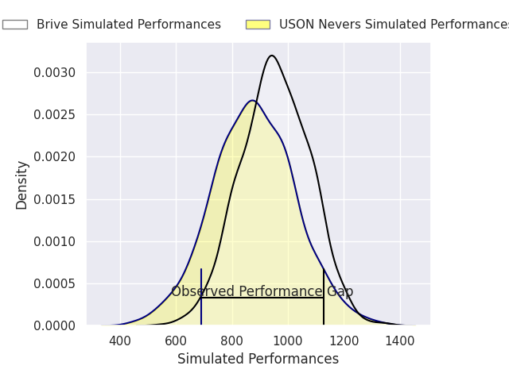
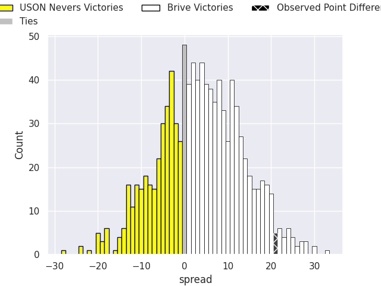
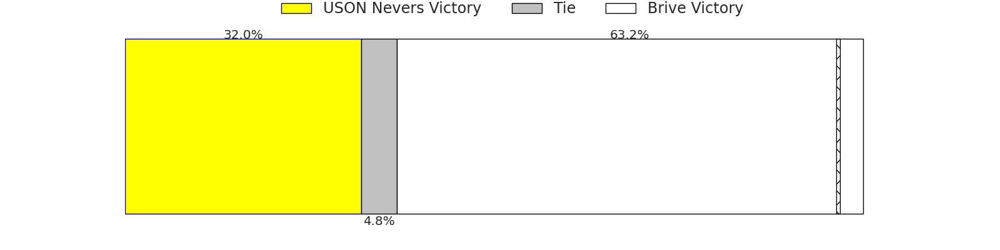

HEADERSTART
---
layout: page
title: USON Nevers V Brive on 2026/10/30, 12.0 to 33.0
date: 2026-10-30
categories: rugby "Pro D2 26/27" match projection
---
## Club Level Predictions

Now that the game has been played, lets see how the club predictions did. I predicted Brive to win by 2.99, and Brive won by 21.0. That's an absolute error of 18.0 for the margin of victory, while my average absolute error has been 14.5 over the past six months. This prediction was more accurate than 32.2% of my recent predictions.

For the Over/Under model, I predicted a total of 47.5 and we have an actual total of 45.0. That's an absolute error of 2.5 compared to a six month average of 14.8. This prediction was more accurate than 89.8% of my recent predictions.
### Projected Performances - Club Model

### Projected Spreads - Club Model

### Projected Results - Club Model

## Player Level Predictions

With the player model, I predicted Brive to win by 3.8,  and Brive won by 21.0. That's an absolute error of 17.2 for the margin of victory, while the average error as been 14.5 for the past six months. So this prediction was more accurate than 26.4% of my recent predictions.
### Projected Performances - Player Model

### Projected Spreads - Player Model

### Projected Results - Player Model

