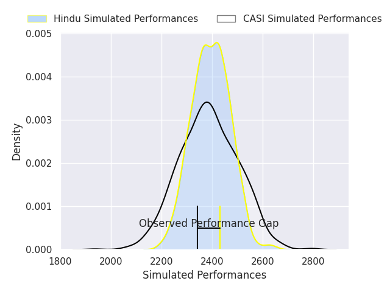
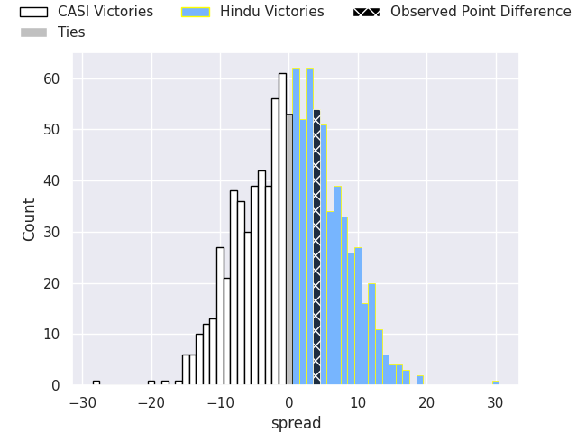
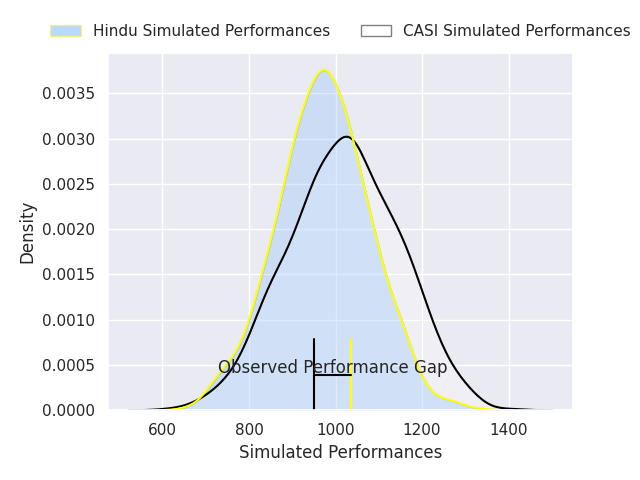
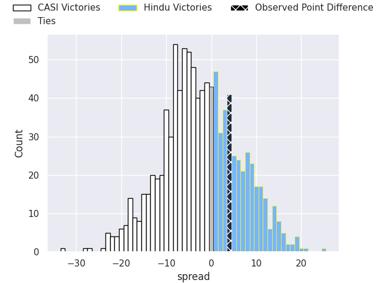

HEADERSTART
---
layout: page
title: CASI V Hindu on 2026/10/31, 12.0 to 16.0
date: 2026-10-31
categories: rugby "URBA Top 14 2026" match projection
---
## Club Level Predictions

Now that the game has been played, lets see how the club predictions did. I predicted Hindu to win by 0.43, and Hindu won by 4.0. That's an absolute error of 3.6 for the margin of victory, while my average absolute error has been 14.5 over the past six months. This prediction was more accurate than 82.9% of my recent predictions.

For the Over/Under model, I predicted a total of 52.5 and we have an actual total of 28.0. That's an absolute error of 24.5 compared to a six month average of 14.8. This prediction was more accurate than 18.2% of my recent predictions.
### Projected Performances - Club Model

### Projected Spreads - Club Model

### Projected Results - Club Model

## Player Level Predictions

With the player model, I predicted CASI to win by 2.31,  and Hindu won by 4.0. That's an absolute error of 6.3 for the margin of victory, while the average error as been 14.5 for the past six months. So this prediction was more accurate than 56.6% of my recent predictions.
### Projected Performances - Player Model

### Projected Spreads - Player Model

### Projected Results - Player Model

