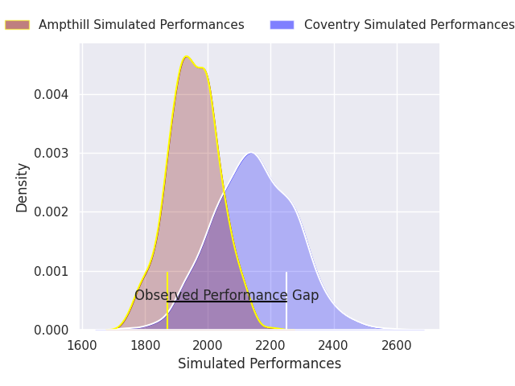
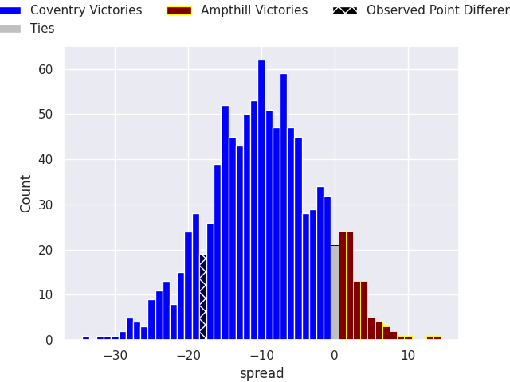
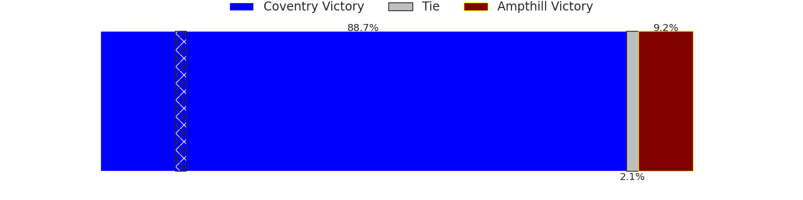
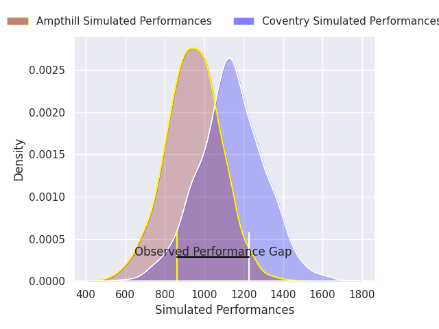
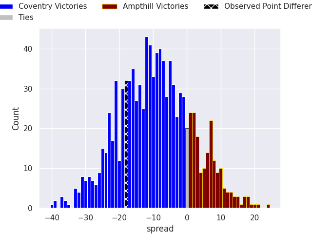

HEADERSTART
---
layout: page
title: Coventry V Ampthill on 2026/10/31, 35.0 to 17.0
date: 2026-10-31
categories: rugby "RFU Championship 26/27" match projection
---
## Club Level Predictions

Now that the game has been played, lets see how the club predictions did. I predicted Coventry to win by 9.74, and Coventry won by 18.0. That's an absolute error of 8.3 for the margin of victory, while my average absolute error has been 14.5 over the past six months. This prediction was more accurate than 62.6% of my recent predictions.

For the Over/Under model, I predicted a total of 56.5 and we have an actual total of 52.0. That's an absolute error of 4.5 compared to a six month average of 14.8. This prediction was more accurate than 80.5% of my recent predictions.
### Projected Performances - Club Model

### Projected Spreads - Club Model

### Projected Results - Club Model

## Player Level Predictions

With the player model, I predicted Coventry to win by 9.56,  and Coventry won by 18.0. That's an absolute error of 8.4 for the margin of victory, while the average error as been 14.5 for the past six months. So this prediction was more accurate than 49.0% of my recent predictions.
### Projected Performances - Player Model

### Projected Spreads - Player Model

### Projected Results - Player Model

