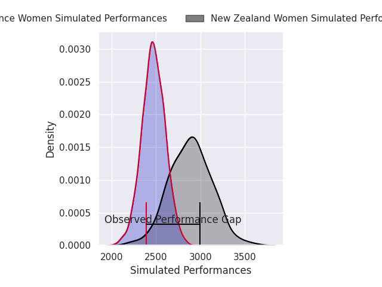
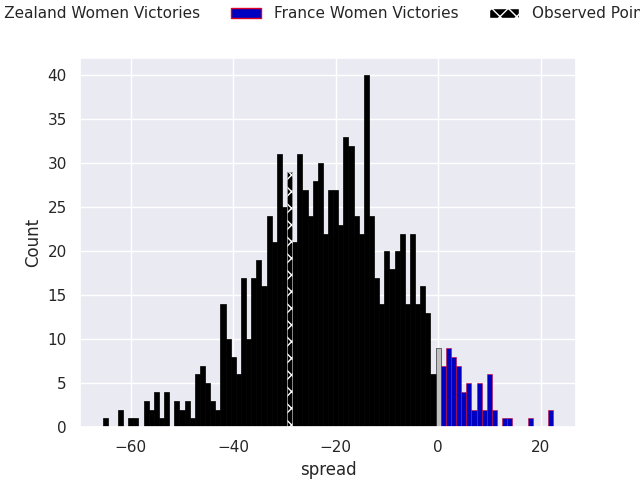

HEADERSTART
---
layout: page
title: New Zealand Women V France Women on 2026/10/31, 36.0 to 7.0
date: 2026-10-31
categories: rugby "WXV Global Series 2026" match projection
---
## Club Level Predictions

Now that the game has been played, lets see how the club predictions did. I predicted New Zealand Women to win by 20.81, and New Zealand Women won by 29.0. That's an absolute error of 8.2 for the margin of victory, while my average absolute error has been 14.5 over the past six months. This prediction was more accurate than 63.1% of my recent predictions.

For the Over/Under model, I predicted a total of 47.5 and we have an actual total of 43.0. That's an absolute error of 4.5 compared to a six month average of 14.8. This prediction was more accurate than 80.5% of my recent predictions.
### Projected Performances - Club Model

### Projected Spreads - Club Model

### Projected Results - Club Model

