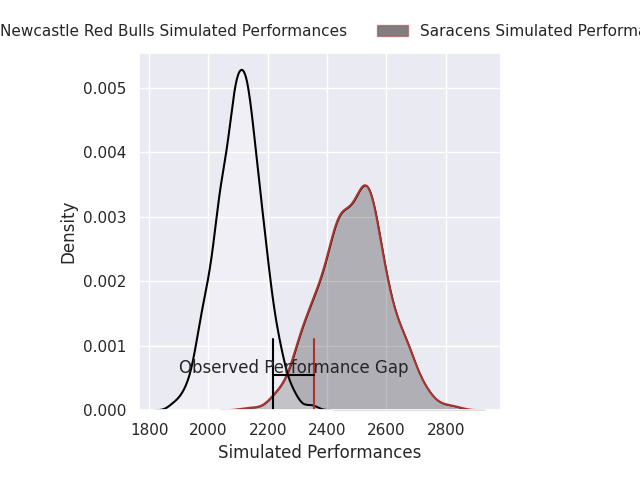
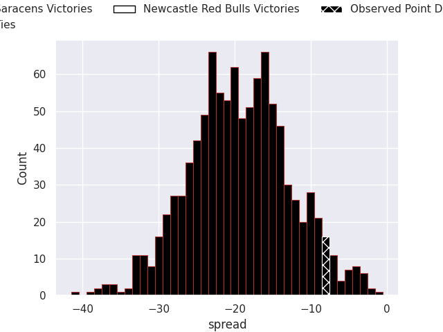

HEADERSTART
---
layout: page
title: Saracens V Newcastle Red Bulls on 2026/10/31, 39.0 to 31.0
date: 2026-10-31
categories: rugby "Gallagher Premiership 26/27" match projection
---
## Club Level Predictions

Now that the game has been played, lets see how the club predictions did. I predicted Saracens to win by 19.31, and Saracens won by 8.0. That's an absolute error of 11.3 for the margin of victory, while my average absolute error has been 14.5 over the past six months. This prediction was more accurate than 52.5% of my recent predictions.

For the Over/Under model, I predicted a total of 48.5 and we have an actual total of 70.0. That's an absolute error of 21.5 compared to a six month average of 14.8. This prediction was more accurate than 24.0% of my recent predictions.
### Projected Performances - Club Model

### Projected Spreads - Club Model

### Projected Results - Club Model

